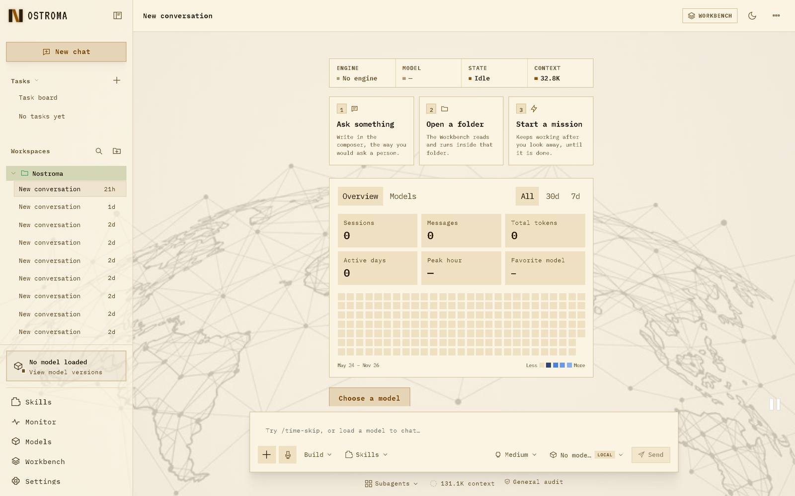

<p align="center">
  <picture>
    <source media="(prefers-color-scheme: dark)" srcset="apps/host/public/brand/nostroma-lockup-dark.svg">
    
  </picture>
</p>

<h3 align="center">Leistungsstarke KI auf deinem eigenen Computer.</h3>
<p align="center">Chatten, programmieren und mit Bildern arbeiten, lokal.</p>

<p align="center">
  <a href="#modelle">Modelle</a> · <a href="#installation"><b>Installation</b></a> ·
  <a href="#hardware">Hardware</a> · <a href="#tools">Tools</a> ·
  <a href="#hilfe">Hilfe</a>
</p>

<p align="center">
  <a href="https://github.com/earenbaz80/Nostroma/releases/latest"></a>
  <a href="LICENSE"></a>
</p>

<p align="center"><sub><a href="README.md">English</a> · <a href="README.zh-CN.md">简体中文</a> · <a href="README.ja.md">日本語</a> · <b>Deutsch</b> · <a href="README.fr.md">Français</a> · <a href="README.es.md">Español</a> · <a href="README.pt-BR.md">Português</a> · <a href="README.pl.md">Polski</a></sub></p>

**Kostenlos, Open Source und ganz in deiner Hand.** Nutze Nostroma auf dem Desktop oder mit deinen liebsten Coding-Tools. Kein Konto nötig.

## Modelle

Wir empfehlen **zuerst ISTA-DASLab**, danach **Unsloth** und andere Anbieter, soweit ein passendes Modell in deinen Speicher passt.

<details>
<summary> &nbsp;<b>Qwen3.8-Flash-Next</b></summary>

| Anbieter | Auswahl |
| --- | --- |
| **ISTA-DASLab · empfohlen** | Q2\_0, IQ2\_XS, IQ3\_XXS, IQ3\_S. [Coder: IQ1\_M](docs/MODELS.md#coder) zum Programmieren. |
| **Unsloth** | UD-IQ4\_XS, UD-Q4\_K\_XL, UD-Q5\_K\_XL, UD-Q6\_K\_XL, Q8\_0 |
| **Gyro · agentionai** | [Gyro-S, Gyro-M](https://huggingface.co/agentionai/Qwen3.8-Flash-Next-Gyro-GGUF). Geringerer Speicherbedarf, aber langsamer. |
| **Weitere Optionen** | [Swift 1.5](docs/MODELS.md#swift-15), [NVFP4](docs/NVFP4.md), [OrcaRouter](docs/ORCA.md) |

[Größen, Speicherbedarf und Kompatibilität vergleichen](docs/MODELS.md).

</details>

<details>
<summary> &nbsp;<b>Qwen3.6-35B-A3B</b></summary>

**Unsloth:** UD-Q4_K_XL, UD-Q6_K_XL, Q8_0. Das sind die derzeit dokumentierten Pakete für dieses Modell.

[Modellanleitung und Kompatibilität](docs/QWEN36.md).

</details>

<a id="the-other-sizes"></a>

Unsicher, was passt? [Wähle ein Modell für deinen Computer](docs/MODELS.md#pick-by-memory).

## Installation

<a id="option-a-the-nostroma-app"></a>

### Desktop-App

**[Nostroma für Windows oder Linux herunterladen →](https://github.com/earenbaz80/Nostroma/releases/latest)**

Installiere die App, wähle ein Modell und leg mit dem Chat los. Es gibt einen Installer pro System. Beim ersten Start lädt die App die Engine für deine Grafikkarte herunter. [Hilfe zum Installer](docs/INSTALL.md#the-app).

<sub>Dateien: `Nostroma-0.2.16-windows-x64-setup.exe` · `Nostroma-0.2.16-linux-x86_64.AppImage`</sub>

<p align="center">
  
  <br><sub>Chat, Dateien und Live-Vorschau in einem Fenster.</sub>
</p>

<a id="option-b-the-terminal-one-line"></a>

### Terminal-App

Lieber im Terminal? Installiere Nostroma und starte dann **`nostroma launch`**.

<details open>
<summary><b>Installationsbefehle</b></summary>

**Linux**

```sh
curl -fsSL --connect-timeout 15 --max-time 120 https://github.com/earenbaz80/Nostroma/releases/latest/download/install.sh -o install.sh && sh install.sh
```

**Windows PowerShell**

```powershell
irm -TimeoutSec 120 https://github.com/earenbaz80/Nostroma/releases/latest/download/install.ps1 | iex
```

Öffne unter Windows danach ein neues Terminal. Dann:

```sh
nostroma launch
```

Folge den Anweisungen, um ein Modell herunterzuladen und zu starten. [Terminal-Anleitung](docs/TERMINAL_LAUNCH.md).

</details>

<p align="center">
  
  <br><sub>Behalte Modell und Hardware im Blick, während es läuft.</sub>
</p>

<a id="build-from-source"></a>

[Aus dem Quellcode bauen](docs/SOURCE_INSTALL.md) · [Docker](docs/DOCKER.md) · [Vollständige Installationsanleitung](docs/INSTALL.md)

<a id="what-you-need"></a>

## Hardware

| Unterstützte Hardware | Anleitung |
| --- | --- |
| **NVIDIA GeForce RTX 20 / 30 / 40 / 50** | [NVIDIA-Setup](docs/INSTALL.md#what-you-need) |
| **AMD Radeon RX 7700 / 7800 / 7900, RX 9060 / 9070, AI PRO R9700** | [AMD-Setup](docs/AMD_HIP.md) |
| **AMD Radeon RX 6800 / 6900 · experimentell** | [RX-6000-Setup](docs/AMD_HIP.md#rdna2-gfx1030) |
| **Intel Arc · Linux** | [Intel-Setup](docs/INTEL_ARC.md) |
| **AMD Ryzen AI Max · Strix Halo** | [Strix-Halo-Setup](docs/STRIX_HALO.md) |

<a id="using-it"></a>

## Tools

**Claude Code · Codex CLI · OpenCode · oh-my-pi · pi.dev · Hermes Agent · OpenClaw**, und weitere über die OpenAI- und Anthropic-kompatiblen APIs.

Führe **`nostroma connect`** aus, um die Einrichtung für dein Tool zu sehen. [Verbindungsanleitung](docs/TERMINAL_LAUNCH.md#connect-your-apps-nostroma-connect).

<a id="guides"></a>
<a id="how-fast-is-it"></a>
<a id="how-does-it-work"></a>
<a id="something-went-wrong"></a>

## Hilfe

[Alle Anleitungen](docs) · [Fehlerbehebung](docs/TROUBLESHOOTING.md) · [Fehler melden](https://github.com/earenbaz80/Nostroma/issues/new/choose) ·
[Benchmarks](docs/COMMUNITY_BENCHMARKS.md) · [So funktioniert es](docs/HOW_IT_WORKS.md) · [Mitmachen](CONTRIBUTING.md)

[MIT-Lizenz](LICENSE) · [Danksagung und Modelllizenzen](docs/HOW_IT_WORKS.md#credits) · [Datenschutz](docs/SAFETY.md)

<a id="option-c-let-your-ai-set-it-up"></a>

<sub>Für KI-Tools und automatische Leser: <a href="AGENTS.md">technische Referenz</a> · <a href="docs/AI_SETUP.md">Setup-Anleitung</a>.</sub>
