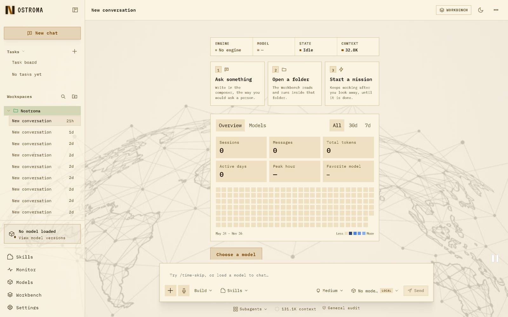

<p align="center">
  <picture>
    <source media="(prefers-color-scheme: dark)" srcset="apps/host/public/brand/nostroma-lockup-dark.svg">
    
  </picture>
</p>

<h3 align="center">Une IA puissante sur votre propre ordinateur.</h3>
<p align="center">Discutez, programmez et travaillez avec des images, en local.</p>

<p align="center">
  <a href="#modèles">Modèles</a> · <a href="#installation"><b>Installation</b></a> ·
  <a href="#matériel">Matériel</a> · <a href="#outils">Outils</a> ·
  <a href="#aide">Aide</a> · <a href="#soutiens">Soutiens</a>
</p>

<p align="center">
  <a href="https://github.com/earenbaz80/Nostroma/releases/latest"></a>
  <a href="LICENSE"></a>
</p>

<p align="center"><sub><a href="README.md">English</a> · <a href="README.zh-CN.md">简体中文</a> · <a href="README.ja.md">日本語</a> · <a href="README.de.md">Deutsch</a> · <b>Français</b> · <a href="README.es.md">Español</a> · <a href="README.pt-BR.md">Português</a> · <a href="README.pl.md">Polski</a></sub></p>

**Gratuit, open source, et à vous de l'exécuter.** Utilisez Nostroma sur votre bureau ou avec vos outils de programmation préférés. Aucun compte nécessaire.

## Modèles

Nous recommandons **d'abord ISTA-DASLab**, puis **Unsloth** et d'autres fournisseurs, lorsqu'un modèle compatible tient en mémoire.

<details>
<summary> &nbsp;<b>Qwen3.8-Flash-Next</b></summary>

| Fournisseur | Choix |
| --- | --- |
| **ISTA-DASLab · recommandé** | Q2\_0, IQ2\_XS, IQ3\_XXS, IQ3\_S. [Coder : IQ1\_M](docs/MODELS.md#coder) pour programmer. |
| **Unsloth** | UD-IQ4\_XS, UD-Q4\_K\_XL, UD-Q5\_K\_XL, UD-Q6\_K\_XL, Q8\_0 |
| **Gyro · agentionai** | [Gyro-S, Gyro-M](https://huggingface.co/agentionai/Qwen3.8-Flash-Next-Gyro-GGUF). Utilise moins de mémoire, mais plus lent. |
| **Autres options** | [Swift 1.5](docs/MODELS.md#swift-15), [NVFP4](docs/NVFP4.md), [OrcaRouter](docs/ORCA.md) |

[Comparer les tailles, la mémoire nécessaire et la compatibilité](docs/MODELS.md).

</details>

<details>
<summary> &nbsp;<b>Qwen3.6-35B-A3B</b></summary>

**Unsloth:** UD-Q4_K_XL, UD-Q6_K_XL, Q8_0. Ce sont les paquets actuellement documentés pour ce modèle.

[Guide du modèle et compatibilité](docs/QWEN36.md).

</details>

<a id="the-other-sizes"></a>

Vous ne savez pas ce qui tient ? [Choisir un modèle pour votre ordinateur](docs/MODELS.md#pick-by-memory).

## Installation

<a id="option-a-the-nostroma-app"></a>

### Application de bureau

**[Télécharger Nostroma pour Windows, Linux ou Mac →](https://github.com/earenbaz80/Nostroma/releases/latest)**

Installez l'application, choisissez un modèle et commencez à discuter. Il y a un seul installateur par système. Au premier lancement, l'application télécharge le moteur de votre carte graphique. [Aide pour l'installateur](docs/INSTALL.md#the-app).

<sub>Fichiers: `Strata-0.2.15-windows-x64-setup.exe` · `Strata-0.2.15-linux-x86_64.AppImage` · `Strata-0.2.15-macos-arm64.dmg`</sub>

<p align="center">
  
  <br><sub>Discussion, fichiers et aperçu en direct dans une seule fenêtre.</sub>
</p>

<a id="option-b-the-terminal-one-line"></a>

### Application Terminal

Vous préférez le terminal ? Installez Nostroma, puis lancez **`nostroma launch`**.

<details open>
<summary><b>Commandes d'installation</b></summary>

**Linux / Mac**

```sh
curl -fsSL --connect-timeout 15 --max-time 120 https://github.com/earenbaz80/Nostroma/releases/latest/download/install.sh -o install.sh && sh install.sh
```

**Windows PowerShell**

```powershell
irm -TimeoutSec 120 https://github.com/earenbaz80/Nostroma/releases/latest/download/install.ps1 | iex
```

Sous Windows, ouvrez ensuite un nouveau terminal. Puis :

```sh
nostroma launch
```

Suivez les invites pour télécharger et démarrer un modèle. [Guide du Terminal](docs/TERMINAL_LAUNCH.md).

</details>

<p align="center">
  
  <br><sub>Suivez votre modèle et votre matériel pendant qu'il tourne.</sub>
</p>

<a id="build-from-source"></a>

[Compiler depuis les sources](docs/SOURCE_INSTALL.md) · [Docker](docs/DOCKER.md) · [Guide d'installation complet](docs/INSTALL.md)

<a id="what-you-need"></a>

## Matériel

| Matériel pris en charge | Guide |
| --- | --- |
| **NVIDIA GeForce RTX 20 / 30 / 40 / 50** | [Installation NVIDIA](docs/INSTALL.md#what-you-need) |
| **AMD Radeon RX 7700 / 7800 / 7900, RX 9060 / 9070, AI PRO R9700** | [Installation AMD](docs/AMD_HIP.md) |
| **AMD Radeon RX 6800 / 6900 · expérimental** | [Installation RX 6000](docs/AMD_HIP.md#rdna2-gfx1030) |
| **Intel Arc · Linux** | [Installation Intel](docs/INTEL_ARC.md) |
| **Apple Silicon · M1 ou plus récent** | [Installation sur Mac](docs/MAC.md) |
| **AMD Ryzen AI Max · Strix Halo** | [Installation Strix Halo](docs/STRIX_HALO.md) |

<a id="using-it"></a>

## Outils

**Claude Code · Codex CLI · OpenCode · oh-my-pi · pi.dev · Hermes Agent · OpenClaw**, et d'autres via les API compatibles OpenAI et Anthropic.

Lancez **`nostroma connect`** pour voir la configuration de votre outil. [Guide de connexion](docs/TERMINAL_LAUNCH.md#connect-your-apps-nostroma-connect).

<a id="guides"></a>
<a id="how-fast-is-it"></a>
<a id="how-does-it-work"></a>
<a id="something-went-wrong"></a>

## Aide

[Tous les guides](docs) · [Dépannage](docs/TROUBLESHOOTING.md) · [Signaler un bogue](https://github.com/earenbaz80/Nostroma/issues/new/choose) ·
[Benchmarks](docs/COMMUNITY_BENCHMARKS.md) · [Comment ça marche](docs/HOW_IT_WORKS.md) · [Contribuer](CONTRIBUTING.md)

## Soutiens

Merci à toutes les personnes qui soutiennent Nostroma.

<!-- supporters:start (one line per public supporter, newest last; copy a line and change the GitHub name in all four places) -->
<a href="https://github.com/ryan4yin"></a>
<a href="https://github.com/themactep"></a>
<a href="https://github.com/macintog"></a>
<a href="https://github.com/bisonbet"></a>
<a href="https://github.com/vizv"></a>
<a href="https://github.com/kod88vn"></a>
<a href="https://github.com/seoulworker"></a>
<a href="https://github.com/jackyini"></a>
<a href="https://github.com/router0mail"></a>
<!-- supporters:end -->

[Licence MIT](LICENSE) · [Crédits et licences des modèles](docs/HOW_IT_WORKS.md#credits) · [Confidentialité](docs/SAFETY.md)

<a id="option-c-let-your-ai-set-it-up"></a>

<sub>Pour les outils d'IA et les lecteurs automatiques : <a href="AGENTS.md">référence technique</a> · <a href="docs/AI_SETUP.md">instructions d'installation</a>.</sub>
