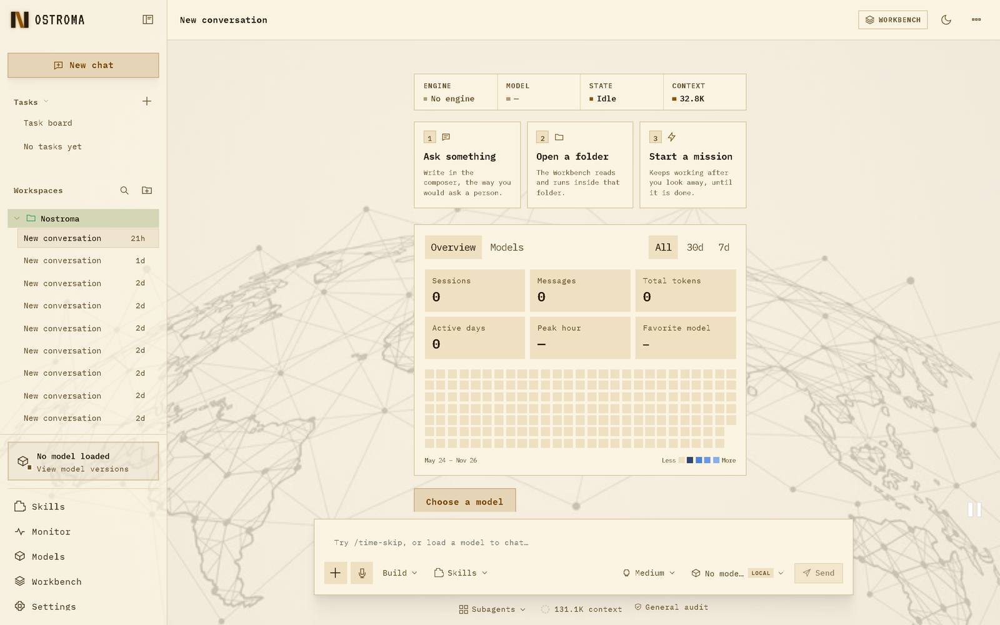

<p align="center">
  <picture>
    <source media="(prefers-color-scheme: dark)" srcset="apps/host/public/brand/nostroma-lockup-dark.svg">
    
  </picture>
</p>

<h3 align="center">あなた自身のパソコンで、高性能な AI を。</h3>
<p align="center">チャット、コーディング、画像の処理を、すべてローカルで。</p>

<p align="center">
  <a href="#モデル">モデル</a> · <a href="#インストール"><b>インストール</b></a> ·
  <a href="#ハードウェア">ハードウェア</a> · <a href="#ツール">ツール</a> ·
  <a href="#ヘルプ">ヘルプ</a> · <a href="#支援者">支援者</a>
</p>

<p align="center">
  <a href="https://github.com/earenbaz80/Nostroma/releases/latest"></a>
  <a href="LICENSE"></a>
</p>

<p align="center"><sub><a href="README.md">English</a> · <a href="README.zh-CN.md">简体中文</a> · <b>日本語</b> · <a href="README.de.md">Deutsch</a> · <a href="README.fr.md">Français</a> · <a href="README.es.md">Español</a> · <a href="README.pt-BR.md">Português</a> · <a href="README.pl.md">Polski</a></sub></p>

**無料でオープンソース。自分の環境で動かせます。** デスクトップで、またはお好みのコーディングツールと一緒に Nostroma を使えます。アカウントは不要です。

## モデル

まず **ISTA-DASLab** をおすすめします。次に **Unsloth** などの提供元です。メモリに収まる互換モデルがある場合に選べます。

<details>
<summary> &nbsp;<b>Qwen3.8-Flash-Next</b></summary>

| 提供元 | 選択肢 |
| --- | --- |
| **ISTA-DASLab · おすすめ** | Q2\_0, IQ2\_XS, IQ3\_XXS, IQ3\_S。[Coder: IQ1\_M](docs/MODELS.md#coder)（コーディング向け）。 |
| **Unsloth** | UD-IQ4\_XS, UD-Q4\_K\_XL, UD-Q5\_K\_XL, UD-Q6\_K\_XL, Q8\_0 |
| **Gyro · agentionai** | [Gyro-S, Gyro-M](https://huggingface.co/agentionai/Qwen3.8-Flash-Next-Gyro-GGUF)。メモリ使用量は少ないですが、動作は遅くなります。 |
| **その他の選択肢** | [Swift 1.5](docs/MODELS.md#swift-15), [NVFP4](docs/NVFP4.md), [OrcaRouter](docs/ORCA.md) |

[サイズ、必要なメモリ、互換性を比べる](docs/MODELS.md)。

</details>

<details>
<summary> &nbsp;<b>Qwen3.6-35B-A3B</b></summary>

**Unsloth:** UD-Q4_K_XL, UD-Q6_K_XL, Q8_0。現在、このモデルで文書化されているパックです。

[モデルガイドと互換性](docs/QWEN36.md)。

</details>

<a id="the-other-sizes"></a>

どれが動くかわからない場合は、[お使いのパソコンに合うモデルを選ぶ](docs/MODELS.md#pick-by-memory)。

## インストール

<a id="option-a-the-nostroma-app"></a>

### デスクトップアプリ

**[Windows、Linux 用の Nostroma をダウンロード →](https://github.com/earenbaz80/Nostroma/releases/latest)**

アプリをインストールし、モデルを選んで、チャットを始めましょう。インストーラーはシステムごとに1つです。初回起動時に、アプリがお使いのグラフィックスカード用のエンジンをダウンロードします。[インストーラーのヘルプ](docs/INSTALL.md#the-app)。

<sub>ファイル: `Nostroma-0.2.15-windows-x64-setup.exe` · `Nostroma-0.2.15-linux-x86_64.AppImage`</sub>

<p align="center">
  
  <br><sub>チャット、ファイル、ライブプレビューを1つのウィンドウで。</sub>
</p>

<a id="option-b-the-terminal-one-line"></a>

### ターミナルアプリ

ターミナルのほうが好みですか？ Nostroma をインストールして、**`nostroma launch`** を実行します。

<details open>
<summary><b>インストールコマンド</b></summary>

**Linux**

```sh
curl -fsSL --connect-timeout 15 --max-time 120 https://github.com/earenbaz80/Nostroma/releases/latest/download/install.sh -o install.sh && sh install.sh
```

**Windows PowerShell**

```powershell
irm -TimeoutSec 120 https://github.com/earenbaz80/Nostroma/releases/latest/download/install.ps1 | iex
```

Windows では、インストール後に新しいターミナルを開きます。そのあと:

```sh
nostroma launch
```

画面の案内に従って、モデルをダウンロードして起動します。[ターミナルガイド](docs/TERMINAL_LAUNCH.md)。

</details>

<p align="center">
  
  <br><sub>動作中のモデルとハードウェアの状態を確認できます。</sub>
</p>

<a id="build-from-source"></a>

[ソースからビルド](docs/SOURCE_INSTALL.md) · [Docker](docs/DOCKER.md) · [インストールガイド（全文）](docs/INSTALL.md)

<a id="what-you-need"></a>

## ハードウェア

| 対応ハードウェア | ガイド |
| --- | --- |
| **NVIDIA GeForce RTX 20 / 30 / 40 / 50 シリーズ** | [NVIDIA のセットアップ](docs/INSTALL.md#what-you-need) |
| **AMD Radeon RX 7700 / 7800 / 7900、RX 9060 / 9070、AI PRO R9700** | [AMD のセットアップ](docs/AMD_HIP.md) |
| **AMD Radeon RX 6800 / 6900 · 試験的** | [RX 6000 のセットアップ](docs/AMD_HIP.md#rdna2-gfx1030) |
| **Intel Arc · Linux** | [Intel のセットアップ](docs/INTEL_ARC.md) |
| **AMD Ryzen AI Max · Strix Halo** | [Strix Halo のセットアップ](docs/STRIX_HALO.md) |

<a id="using-it"></a>

## ツール

**Claude Code · Codex CLI · OpenCode · oh-my-pi · pi.dev · Hermes Agent · OpenClaw**。OpenAI 互換と Anthropic 互換の API を通じて、ほかのツールも使えます。

**`nostroma connect`** を実行すると、お使いのツールの設定方法が表示されます。[接続ガイド](docs/TERMINAL_LAUNCH.md#connect-your-apps-nostroma-connect)。

<a id="guides"></a>
<a id="how-fast-is-it"></a>
<a id="how-does-it-work"></a>
<a id="something-went-wrong"></a>

## ヘルプ

[すべてのガイド](docs) · [トラブルシューティング](docs/TROUBLESHOOTING.md) · [不具合を報告](https://github.com/earenbaz80/Nostroma/issues/new/choose) ·
[ベンチマーク](docs/COMMUNITY_BENCHMARKS.md) · [仕組み](docs/HOW_IT_WORKS.md) · [貢献する](CONTRIBUTING.md)

## 支援者

Nostroma を支えてくださるすべての方に感謝します。

<!-- supporters:start (one line per public supporter, newest last; copy a line and change the GitHub name in all four places) -->
<a href="https://github.com/ryan4yin"></a>
<a href="https://github.com/themactep"></a>
<a href="https://github.com/macintog"></a>
<a href="https://github.com/bisonbet"></a>
<a href="https://github.com/vizv"></a>
<a href="https://github.com/kod88vn"></a>
<a href="https://github.com/seoulworker"></a>
<a href="https://github.com/jackyini"></a>
<a href="https://github.com/router0mail"></a>
<!-- supporters:end -->

[MIT ライセンス](LICENSE) · [クレジットとモデルのライセンス](docs/HOW_IT_WORKS.md#credits) · [プライバシー](docs/SAFETY.md)

<a id="option-c-let-your-ai-set-it-up"></a>

<sub>AI ツールと自動リーダー向け: <a href="AGENTS.md">技術リファレンス</a> · <a href="docs/AI_SETUP.md">セットアップ手順</a></sub>
